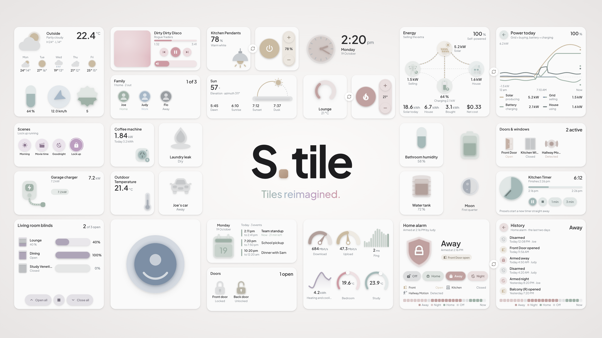

# S.tile

**Tiles reimagined.** Soft, square tiles for Home Assistant dashboards, with a graphic for every kind of device, three sizes, three styles and a full visual editor.

> **Beta (0.1).** Everything below works, but expect changes before 1.0. Please report problems under **Issues**.



## What's in 0.1

- **31 tile types** in 15 groups: lights, media, climate, sensors, weather, time (clock, timer, calendar), robot vacuums, people and trackers, covers, security (alarm panels and locks), scenes and scripts, graphs, plugs and EV chargers, sun and moon, and energy (solar, battery and grid, including Power Flow Card Plus configs).
- **Groups** of lights, covers, locks, sensors, timers, people, plugs, scenes and scripts, and graphs, with per-item order, names, colours and taps.
- **Three sizes** (1 × 1, 2 × 1, 2 × 2) and **Minimal, Basic and Detailed** styles, about 235 layouts in all.
- **90 graphics** to pick from, which fill, glow and move with the device's state.
- **Flip tiles:** 2 × 2 tiles turn over to more detail, such as power today, alarm history, the vacuum map or climate modes.
- **Works with any theme.** S.tile carries its own palette in light and dark versions, and your theme's colours win where it defines them.

## Install

### HACS (recommended)

1. In Home Assistant open **HACS**, then **⋮ → Custom repositories**.
2. Add this repository's URL with the type **Dashboard**.
3. Find **S.tile**, select **Download**, then reload the browser (on the mobile app, clear the frontend cache).

### Manual

1. Download `s-tile-card.js` from the latest release and copy it to `/config/www/`.
2. Add the resource `/local/s-tile-card.js?v=0.2.0` (Settings › Dashboards › ⋮ › Resources), type **JavaScript module**.
3. Change `?v=` each time you replace the file.

### Add a card

Edit a dashboard, select **Add card** and pick **S.tile** (or add `type: custom:s-tile-card`). The editor walks you through choosing a device, a layout and the details.

**Font (optional):** the tiles are designed around Plus Jakarta Sans. Add `https://fonts.googleapis.com/css2?family=Plus+Jakarta+Sans:wght@400;500;600;700&display=swap` as a **Stylesheet** resource to use it; otherwise your theme's font is used.

## The editor

The card editor has three menus.

1. **Choose a tile:** a new card opens here with nothing selected. Pick a device or an entity. S.tile suggests cards that suit it, each shown as a live preview using your own states. Pick one to start from and you land in Layout. **Go to layout options** skips the suggestions.
   The suggestions are shown one at a time: swipe, use the arrows or tap a dot to move through them, and tap the card you want.
   **Start from scratch** shows every kind of card in 15 groups: Lights, Media, Climate, Sensors, Weather, Time, Cleaning, People, Covers, Security, Scenes and scripts, Graphs, Plugs and EV, Sun and moon, and Energy. Pick a group to see all its layouts (previewed with sample states), pick one, then choose the entity for it. Clocks need no entity, and sensor and timer groups take their entities under Customise › Content.
2. **Layout:** choose the **Category** (Light, Media player), the **Tile type** (Pendant, Table lamp, Floor lamp, Downlight, LED strip … or Media player, Stereo, HomePod, Nest Mini, Soundbar, TV …), the size and the **Layout**. The layouts are shown as live previews, one at a time, in the same swipeable carousel. A recommendation fills all of this in; change anything here.
3. **Customise:**
   - Name and icon.
   - The extra detail line (1 × 1 detailed styles).
   - Show or hide the graph (lights, detailed). Pick which entity feeds the graph.
   - **History timescale** for every card with a graph, a day strip or counts (lights, sensors, weather elements, climate): 1, 3, 6, 12 or 24 hours (default), 2 or 7 days, or today since midnight. Graphs always show 24 bars spread over the timescale, and the labels follow it ("6 h ago", "2 days low", "Opened · 2 days").
   - The artwork for media players: **Album art** (the entity picture), the **Media graphic**, or an **Animated gradient** in your theme colours that drifts slowly while something is playing.
   - The player that takes the volume controls (media), for example a soundbar.
   - The tap action.
   - Colours and card settings (below).

## Sizes and styles

| Size | Styles |
|---|---|
| 1 × 1 (173 × 173) | **Minimal** graphic only · **Basic** graphic, name and state · **Detailed** icon, name, state and one more detail · **Detailed, no icon** name first, large state, detail under it |
| 2 × 1 (356 × 173) | **Basic** graphic, name, state and buttons · **Detailed** buttons, sliders, graphs and more detail |
| 2 × 2 (356 × 356) | **Minimal** large graphic only · **Basic** graphic with buttons · **Detailed** the full design for the device · **Detailed, no icon** the same with the name first and no icon (lights, climate and weather elements) · **Forecast** (weather) |

Cards are always exactly square (2 × 1: two-to-one) at any width, and the height follows the width.

**Small cards beside a 2 × 2 (sections view):** a sections dashboard gives cards either their own height or a fixed number of 56 px rows, not both, so an exactly square card cannot share rows with a 2 × 2. Put the small cards in a **vertical stack** instead. Two 1 × 1 (or 2 × 1) cards stacked are exactly as tall as a 2 × 2 beside them:

```yaml
type: vertical-stack
grid_options: { columns: 6 }   # half the width of the 2 × 2 beside it (a 2 × 2 is 12 columns)
cards:
  - type: custom:s-tile-card
    entity: light.kitchen_pendants
  - type: custom:s-tile-card
    entity: light.bens_lamp
```

Or turn on **Fill the dashboard grid** (Customise › Card, `fill_grid: true`): the card takes fixed rows and fills its cell so small cards stack on their own, but the shape is then only as close to square as the 56 px rows allow.

Small cards flip to a **button page** on tap (buttons only):

- Dimmable lights: power and a brightness + / − control.
- On/off lights: one large power button.
- Media players: play / pause, next and a volume + / − control.

Tap a blank part of the button page to flip back. Hold any card for more-info.

### Lights
- **Buttons:**
  - Power and brightness steps.
  - Presets: Relax 35 %, Bright 100 %, Night 5 %, warmer or cooler where the light supports it.
  - Night light.
  - Warm and cool buttons when the light supports colour temperature.
- **Sliders:** a brightness slider. On the 2 × 2 detailed card it is one full-width slider that switches between **brightness**, **white** (warm to cool, colour temperature) and **colour** (hue), using the small buttons under the value; only the modes the light supports are offered, and the value beside the graphic follows the chosen mode (%, K, or the colour).
- **History graph:** when the light was on over the history timescale (default the last 24 hours) on the detailed cards, which you can hide.
- When the light is off, every button takes the off colour, the same as the power button.
- **Switches:** light switches get a power button only.
- **Fan lights:** when the light's device has a fan (or `fan_entity`), the blades take the fan colour and curved trails show the speed (one low, two medium, three high). On the 2 × 1 and 2 × 2 cards the fan buttons sit right of the power button in place of the scenes; the 2 × 1 basic keeps a brightness slider below, the 2 × 2 detailed keeps one preset.
- **Light groups** (`card_type: lights`, or Layout › Graphic › *Group: several on one card*): up to 6 lights or switches on one card, titled **Group** unless you name it. Picking a Home Assistant light group fills in its members.
  - 1 × 1: a tap turns them all on or off; the flip has **All on** and **All off**.
  - 2 × 1: each light's graphic, left to right; tap a graphic to toggle that light.
  - 2 × 2: up to 4 rows, each with its graphic (tap to toggle), its state and a brightness slider (a power button for switches), plus **All on** and **All off**.

### Media players

- **Gradient artwork:** the primary colour plus a second colour (`gradient_color`, Customise › Colours; the card background when not set). It drifts while playing.
- **Sonos** (found from the Sonos integration): the 2 × 1 and 2 × 2 detailed cards get two buttons. **Group** lists your other Sonos speakers: tap one to add it to or remove it from this group, with a volume slider for each speaker in the group. **Favourites** shows your Sonos favourites (radio, playlists …) with their artwork, a page at a time (4 on the 2 × 1, 8 on the 2 × 2); tap one to play it. `sonos: false` hides them.
- Album art is kept between updates, so it doesn't flicker or vanish while a track plays, and fades in when the track changes.
- **Artwork:** set with `artwork`.
  - `picture` (default): the album art fills the disc graphic and the artwork panels. The gradient stands in when a track has no picture.
  - `hero`: the media graphic (disc, speaker, TV …) instead of a picture.
  - `gradient`: a soft gradient from your theme and primary colour that drifts slowly while playing and is still when idle. Turned off for people who ask their device for reduced motion.
- **2 × 1:** previous, play / pause, next and a volume slider. Detailed adds the track progress and a group count.
- **2 × 2 detailed:** a full now-playing view with the group and source, progress, shuffle, repeat and volume.

### Climate

- **1 × 1 minimal:** Off when off; when on, the target and the mode.
- **1 × 1 tap:** by default the first tap shows power and the target, the second the modes, the third goes back (`flip_page: both`; `target` or `modes` for one page).
- **Fan speed button:** its icon shows the speed (auto, 1, 2 or 3 bars, quiet, turbo); each tap moves to the next and the card shows it straight away.
- **2 × 2 basic:** mode on the left, − power + in the middle, fan speed on the right. **2 × 2 detailed:** power to the left of − target +.
- **Dampers and room gauges** (2 × 2 detailed): each can have its own colour (`damper_colors`, `room_colors`: `{ entity: colour }`), and the room gauges can follow temperature thresholds (Customise › Colours › Room gauges › Thresholds).
- **Graphics** (`sub_type`): `dial` (a thermostat dial filling to the target), `split` (a wall-mounted split system: the vane lights up and air flows out while running) and `heater` (a flame). Picked from the name, device and modes.
- **Colour per mode:** heat, cool, auto, dry, fan and off each have their own colour (theme defaults: `hamptons-color-14`, `-6`, `-11`, `-5`, `-2`, `-15`). Change any of them under Customise › Colours, saved as `mode_colors`. The card follows what it is doing right now: a system in auto that is cooling uses the cool colour.
- **1 × 1:** the four styles. Tap to flip to power (showing the mode while on) and a target stepper, or set `flip_page: modes` for a page of every mode.
- **2 × 1:**
  - Basic: graphic, name and target, with power, target down and up, fan speed and the Heat / Cool / Auto buttons.
  - Detailed: a target slider, power and every mode, and today hour by hour, coloured by what it was doing (e.g. "Heated 9 h"). `show_graph: false` gives a larger graphic, slider and buttons.
- **2 × 2:**
  - Minimal: a large dial with the target in the middle (or the large graphic).
  - Basic: the dial with a knob and the room temperature, with target down, mode, power, fan and target up.
  - Detailed and detailed, no icon: dial, room temperature and humidity, target steps and every mode, then the bottom of the card (`bottom`):
    - `graph` (default): the room temperature over the last 24 hours as bars, each tinted by what it was doing.
    - `fan`: fan speeds and presets (only those the device has).
    - `rooms`: up to four temperature sensors along the bottom (`rooms: [sensor.living_temperature, …]`); the big number is their average.
    - `dampers`: up to three dampers on the climate device, each with its room temperature, in the bottom half of the card (the dial, target and modes sit in the top half). Tap a damper to open or close it; drag to set the opening. Dampers are found automatically (covers with the damper device class, or "damper" / "zone" in the name, on the same device). Pick your own with `dampers: [cover.…]`, and their temperature sensors with `damper_temps: { cover.living_damper: sensor.living_temperature }`.

### Sensors

- **Temperature and humidity sensors** are in the Sensors category (and suggested for those entities), with threshold colours (Customise › Colours › Thresholds).
- **1 × 1 detailed:** `front_graph: bars` (columns) or `line` puts the history graph on the front, coloured by the thresholds; no flip needed. Works for temperature, humidity, power, battery, air quality and other number sensors.
- **Open / closed and presence** (`binary_sensor`, `person`): door, double door, window, awning window, motion / occupancy, person, leak, smoke / gas. Picked from the device class and name.
  - The state ("Open", "Detected", "Home") and how long it has been that way ("Open for 3 min", "Closed since 2:14 pm").
  - There is nothing to control, so a 1 × 1 flips to **today**: how many times it opened (or how long it was active), the day hour by hour and the last change.
  - 2 × 1 basic adds today's count and the device's battery; detailed adds the longest open and the day strip.
  - 2 × 2 detailed (and no icon) adds the last four changes with their times and durations.
  - Colours: doors and windows `--doors`, motion `--sensors`, people `--garden`, leak and smoke `--security`.
- **Numbers** (`sensor`): battery, power, air quality / CO₂, light level, or any other number. Temperature, humidity, wind, UV, pressure, rain and solar sensors still use the weather element cards.
  - The value with a word for the level ("Low · replace soon", "Stuffy · open a window"), the 24 h low and high (power: average and peak) and the last 24 hours as bars.
  - Battery and CO₂ use threshold colours by default (choose Single colour to turn them off). `min` and `max` set the range for the graphic.
- **Groups** (`card_type: group`, `entities: [...]`): up to six open / closed sensors on one card.
  - 1 × 1: one graphic and a summary ("2 open · Front Door, Kitchen Window"); tap to flip to the list.
  - 2 × 1: each sensor's graphic and name in a row, open ones lit.
  - 2 × 2: a list with each state and how long, open or active first.
  - Picking a door or window sensor under Choose a tile also offers a "Doors & windows" group.

### Clock

- **Hands** (`hand_color`, Customise › Colours): the hour and minute hands in their own colour; blank keeps the primary colour. Timers have the same for the **marker** on the edge of the pie.
- **Hour marks** (`show_ticks: false` hides them).
- **Time zones** use the time zone database name, `Region/City`, exactly as written there: `Australia/Sydney`, `Europe/London`, `America/New_York`, `America/Los_Angeles`, `Asia/Tokyo`, `Pacific/Auckland`. Capitals and underscores matter; city names that aren't in the database (e.g. `Australia/Newcastle`) won't work, so use the nearest one in the same zone. The editor says whether each one is recognised. The full list: search "list of tz database time zones" (Wikipedia).
- **2 × 2 detailed and digital:** the bottom shows the world clocks or the next events (`clock_bottom: world | events`, with `calendar_entity`); the calendar's colour is under Colours.
A clock needs no entity: under Choose a tile use **Start from scratch › Time** (or set `card_type: clock`).
- **Time zones:** the clock shows this device's time, or any time zone with `time_zone` (an IANA name such as `Australia/Sydney`, `Europe/London`, `America/New_York`). Up to three **world clocks** sit on the larger cards: `world_clocks: [{ name: London, time_zone: Europe/London }, …]`. The times are worked out on the device from the time zone database, so they follow daylight saving with no extra entities. Each world clock says whether it is today, tomorrow or yesterday there.
- 12 or 24 hour from your Home Assistant profile, or set `time_format: '12'` / `'24'`.
- Sunrise and sunset come from `sun.sun`; the next alarm from `alarm_entity` (an `input_datetime` or a timestamp sensor such as the companion app's next alarm).
- The day and date are shown instead of a name; on the 2 × 2 detailed card the header is the place (from the time zone, or your home's name).
- Styles: 1 × 1 (the four styles; tap flips to sunrise, sunset and the alarm), 2 × 1 basic, detailed (world clocks) and **digital** (a large time with the day from sunrise to sunset), 2 × 2 minimal, basic, detailed, detailed no icon and **digital** (a very large time, the day and the next two events from `calendar_entity`).

### Timer

- **Threshold colours by minutes left** (Customise › Colours › Thresholds; `color_mode: thresholds`, `thresholds: [{ value: 0, color: hamptons-color-14 }, { value: 1, color: hamptons-color-11 }, { value: 5, color: hamptons-color-2 }]`): the pie, buttons and progress take the colour while the timer runs or is paused.
- **Presets** (`presets: [1, 3, 5, 10, 15]`, minutes, up to 5; `0.5` = 30 s) under Customise › Content on the detailed cards and the 2 × 2 basic.
- **2 × 2 basic:** Tap action › Flip to the buttons turns it over to the time, −1 / stop / play / restart / +1 and the presets.
- `timer` entities: idle (a timer-off icon in the middle of the pie), running and paused. The pie empties as time runs down, with a single tick at the edge of what is left, and counts down every second.
- Buttons: start / pause, cancel, restart, −1 and +1 min (`timer.change` while running or paused; while idle they set the length for the next start), and presets (`presets: [1, 3, 5, 10, 15]` minutes) that start a new timer straight away.
- **Timer group** (`card_type: timers`, `entities: [timer.pasta, …]`): up to four timers on one card, running first, each with its own start / pause.

### Calendar
- `calendar` entities. Add more with `calendars: [calendar.work, calendar.school]`; each gets its own colour, which you can change under Customise › Colours (one row per calendar), or in YAML with `calendar_colors: { calendar.work: hamptons-color-6 }`. The first calendar follows the primary colour if you set one.
- The graphic shows today's date and lights up while an event is on.
- 1 × 1: tap flips to the next three events. 2 × 1: the graphic on the left with the date above it, and the event on now (with how far through it is) or next, or today's events. 2 × 2: minimal, basic, **agenda** (today and tomorrow, also without the icon) and **week** (this week with a dot per event; tap a day to see its events; the icon shows only with **Show the icon**).

### Robot vacuums

- **Colour per state** (Customise › Colours; `state_colors: { cleaning: hamptons-color-12, docked: hamptons-color-6 }`): cleaning, returning, docked, paused, idle and error each can have their own colour; a colour set for a resting state (docked, paused, idle) lights the graphic in it.
- **1 × 1 basic:** the battery and the state (`76 % · Docked`). **2 × 1:** under the name, where it is (the room or its area) instead of repeating Docked.
- **2 × 2 minimal:** Tap action › Flip to the map and controls. **Basic:** state, battery and fan speed once each. The fan button's icon shows the speed.
- **Pills:** the battery, then as many as you pick (`pill_entities`: filter, brushes, mop …) with your own names (`sensor_names`). On the 2 × 2 they wrap over the map up to three rows; more than that scroll (swipe up on the pills). A part counted below 0 % shows as *overdue*. The state pill is gone from the 2 × 2 map.
- **Map tint** (`map_tint`, on by default) softens the map image to the theme, as on the tracker maps.
- `vacuum` entities. The card looks on the vacuum's device for the extras, or set them yourself:
  - `progress_entity`: the % complete sensor (anything with "progress" in its id).
  - `time_entity`: the cleaning time sensor.
  - `map_entity`: the map, an `image` entity on the vacuum's device (Roborock makes one per floor; the card picks the floor the vacuum is on from its "selected map") or a `camera` with "map" in its id. Used on every 2 × 2: detailed shows it in the top half; basic and minimal flip to it (tap the card) with the pills and every control. `show_map: false` uses the graphic instead.
  - `error_entity`: the error or status sensor. An error lights the graphic in `--security` and shows the message.
- 1 × 1: the four styles; tap flips to start / pause, dock and a suction + / − control.
- 2 × 1 basic: graphic, name and state with start / pause, dock, locate and suction, then battery and suction pills. Detailed: % complete, time and battery, the buttons and what happens next.
- 2 × 2 minimal and basic: the large graphic (basic adds the buttons). Detailed: the map (or graphic) across the top half with the state and battery, the name with % complete at the top right, a progress bar, the buttons (rooms, dock, start / pause, spot, locate) and the suction speeds, centred.
- Buttons take the off colour while docked or idle, and the primary colour while cleaning or heading home.
- All of these can be set under Customise › Content: show the map, the map entity, the % complete sensor and the rooms.
- **Rooms:** the rooms button flips the 2 × 2 card over to choose rooms and clean just those. Rooms come three to a row in pages (six a page under the map, fifteen without it); the arrows in the corner move between pages, and All / None picks every room. Rooms come from the Roborock integration (asked once with `roborock.get_maps`, for the current floor), the vacuum's `rooms` attribute (Dreame and others), or you list them. In the editor, type `Kitchen = 16, Lounge = 17`; in YAML: `rooms: [{ name: Kitchen, segment: 16 }, …]`. By default it calls `vacuum.send_command` with `app_segment_clean` (Roborock / Xiaomi). For other brands set the service: `room_service: { service: vacuum.clean_area, rooms_key: areas, data: {} }`.

### People and device trackers

- **Device graphics** (phone, tablet, laptop, watch) always show the battery level, in the off colour when away or unknown, and a bolt while charging.
- **Battery colours** (Customise › Colours): default rose under 30 %, or your own thresholds (`battery_thresholds`) for the battery pills; `battery_hero: true` colours the device graphic by its battery too.
- **Your own names** for added batteries and sensors (`sensor_names: { sensor.judy_watch_battery_level: Watch }`), under Content.
- **Collage** (1 × 1 and 2 × 1, `style: collage`, `entities`: up to 4 people or devices): a small graphic for each (the 2 × 1 adds the name and the zone or battery, `collage_info: battery`). Tap one to flip to its map.
- The zone appears once: the 2 × 1 battery row and the 2 × 2 map no longer repeat it, and at home the 2 × 2 detailed stats skip "from home". The 2 × 2 basic shows the battery next to the zone.
- **Everyone** is offered among the 2 × 1 and 2 × 2 styles of any tracker card.
- The maps have no zoom buttons.
- `person` and `device_tracker` entities, drawn as a person (with their picture when they have one), phone, tablet, watch, laptop, tag (keys, wallet, bag), car or pet (`sub_type`; picked from the name, icon and device).
- **Zones and colours:** the card is coloured by the zone they are in: Home, Work, School, Gym and every zone you have get a theme colour, grey when away. Under Customise › Colours there is a row per zone, and **Add a location or state** adds your own (a place name your tracker reports, `driving`, `Grandma's` …) with its own colour. In YAML: `zone_colors: { Work: hamptons-color-6, "Grandma's": '#C9A7B6' }`; rename a state with `zone_names: { not_home: Out }`.
- **More batteries:** add any battery sensors (a watch, earbuds, a car …) under Customise › Content (`battery_entities: [sensor.judy_watch_battery_level, …]`); each shows as a pill with a short name and an icon next to the phone's battery.
- **Choose the details** on the 2 × 1 detailed and 2 × 2 cards (`stats`, in order): distance, battery, speed, moving, updated, since, zones today, GPS accuracy, altitude, and your own sensors (`stat_entities`). Up to 3 on the 2 × 1, 4 on the 2 × 2 with the map, 5 with the graphic.
- The details: how long they have been there, battery (and charging) from the phone, distance from home (worked out from the GPS and your home zone), speed while moving, last update, and the day hour by hour coloured by zone (the history timescale applies).
- **Map:** a tap flips any size to the map (`tap_action: flip` is the default for these cards). 1 × 1 and 2 × 1 turn into a map with the name and zone; on the 2 × 2 the whole card turns over, or just the graphic on the basic card (`map_flip: card` or `hero`). Tap the map to turn it back. The map is Home Assistant's own, with the zones and the GPS accuracy circle; devices with no GPS show the zone they are in. `map_zoom` (14) sets the zoom for one place, and the map is softened to the theme unless `map_tint: false`.
- 2 × 1 **map** style: the map on the left, the zone, battery and distance beside it. 2 × 2 detailed: the map across the top half (`show_map: false` for the graphic instead; detailed no icon always uses the graphic).
- **People** (`card_type: people`, `entities: [person.joe, person.judy, …]`, up to 6): who is home and where everyone else is. 2 × 1: a row of people with their zones; 2 × 2: everyone on one map with a list; 1 × 1: how many are home. Offered under Choose a tile when you pick a person.

### Covers

- **Cover groups** (a cover entity with several members in `entity_id`): the 1 × 1 flips to open / stop / close for the whole group; the 2 × 1 flips (by default) to each member's state; the 2 × 2 flips to a slider or button for each member.
- **Group cards** are a graphic of their type in the editor: Layout › Graphic › *Group: several on one card* (covers, sensors, timers, people). The entity from Choose a tile (or a group entity's members) starts the list, and the list can be changed under Content.
- **Less repetition:** the state shows once. 2 × 1 basic has presets along the bottom for blinds and the open / closed timeline for garages and gates; 2 × 1 detailed ends with the timeline; the 2 × 2 head shows the area and the last opening, the big value the state, and under it since when.
- **Garage light:** its own icon and colour (on: lit bulb, primary colour; off: outline, off colour) whatever the door is doing.
- **Confirm before opening** (`confirm_open: true`): a Yes / No on the card before anything opens.
- **Gate buttons:** sliding gates `mdi:gate-arrow-right` / `mdi:gate-arrow-left`, swing gates `mdi:gate-open` / `mdi:gate`.
- **Covers card:** under the name, which ones are open (or "All closed · last moved …") instead of repeating the count.
- `cover` entities, drawn as a roller blind, venetian (position and tilt), curtains, roller shutter, awning, garage door, swing gate, sliding gate or motorised window (`sub_type`; picked from the device class and name). The more colour, the more open (`--covers`); an arrow while it moves.
- Blinds and the like: open, stop and close, a position slider (a little shorter than the buttons) and presets. Venetians switch the one slider between position and tilt with the two small buttons under the value. Only what the cover supports is shown (position, tilt, stop).
- Garages and gates: one big open / close button, stop, and a button for the garage light (`light_entity`) or a walk-through opening (`walk_entity`: a button, script, switch or cover). Left open longer than `open_alert_minutes` (30; 0 turns it off) the card turns to the alert colour.
- 1 × 1: the four styles; a tap flips to open / stop / close with a position stepper (garages and gates: one big button). 2 × 1 basic and detailed. 2 × 2 minimal, basic, detailed and detailed no icon, with today hour by hour (the history timescale applies); a tap turns the 2 × 2 over to the presets (Open, Privacy 70, Half 50, Glare 30, Night 10, Closed; your own with `cover_presets: [{ name: Reading, position: 60, tilt: 50 }]`) and tilt, or for garages and gates to today's openings.
- **Covers** (`card_type: covers`, `entities: [cover.…]`, up to 4): 2 × 1 each with its state; 2 × 2 a slider each with open all, stop and close all.

### Scenes and scripts
- Groups (`card_type: actions`): Customise › *Items* sets each one's order (the arrows), name, colour (the dot opens the theme colours) and picture.
- `scene` and `script` entities share one style. Tap runs it (Tap action › Run it; a running script stops).
- The graphic: a soft disc with the icon. **Ready**: grey. **Just ran**: the solid disc and a tick for a few seconds. **Running** (scripts): solid with a ring, and Stop.
- 1 × 1: minimal, basic (name and when it last ran), detailed (Ready / Done / Running, when, how many devices) and **button** (the whole tile is one big button, its corners following the tile's corner radius). 2 × 1: the graphic, what it does and Run; detailed lists what it sets as pills. 2 × 2: each device the scene sets with its value (or the script's last run and mode), with Run and edit.
- **Groups** (`card_type: actions`, or Layout › Graphic › *Group: several on one card*): scenes and scripts mixed, in your order, up to 6. 1 × 1 grid or list, 2 × 1 row or six tiles, 2 × 2 tiles or a list with Run / Stop per row and Stop all. Customise › **Items**: reorder them, rename them (`entity_names`) and give each its icon or a graphic from the library (`entity_heroes: { scene.movie: tv }`). Each takes its own colour under Colours (`entity_colors`).
- `confirm_run: true` asks Yes / No before running.

### Graphic library
- Customise › Graphic: pick any of 90 graphics (lights, climate and air, media, doors and covers, security, appliances, outdoors, devices) to replace a tile's default graphic (`hero: tv`). Its colour still follows the state. **Default** goes back to the one chosen for the device. Not offered on group tiles, graphs, clocks and calendars, which draw their own.

### Smart plugs and power boards
- A switch is a **smart plug** when it is an outlet, its name says plug, socket, outlet or power point, or its device reports power. The outlet face fills when on; a bolt badge shows while it draws more than 5 W (`idle_watts`).
- Found on the plug's device: power, energy today (or the day's change of its total energy), voltage, current, a countdown (`timer_entity`) and a child lock (`child_lock_entity`). Pick any yourself under Customise, or `none` to ignore one. Cost = energy × `price` (per kWh) or `price_entity`.
- The timer and child-lock buttons appear only when the plug has them. A plug that powers a wireless charger can use Customise › Graphic › **Charging pad** (`hero: chargepad`).
- **Power board**: Layout › Graphic › *Group: several on one card* (`card_type: plugs`, `entities:` up to 6 outlets). Each outlet lights on its own; 2 × 2 has a row per outlet with All on / All off. Rename outlets under Customise › Names.

### EV chargers (`card_type: ev`)
- Point it at the charger's status sensor (or its power sensor). Found on the charger's device: status, power, session energy, lifetime energy, current (number), start/stop (switch or buttons; Easee through `easee.action_command`) and a mode select. Override any with `status_entity`, `power_entity`, `session_entity`, `current_entity`, `switch_entity`, `mode_entity`.
- Status words from OCPP, Easee, Wallbox, Zappi, Ohme, Sigenergy (local) and others become Unplugged, Plugged in, Charging, Done or Fault. With no status (Sigenergy cloud) more than 0.1 kW counts as charging.
- **Cars** (`cars:` a list of devices): S.tile finds each car's battery, charging, plugged-in, location, charge limit, time to full (a time, a duration or "HH:MM" text) and range. A car's battery shows only while the car is home, says it is charging or plugged in, and the charger is busy (status, power, or with no status, that car home and plugged in). A car charging anywhere else never shows. `car_names` renames them.
- No controls on the charger: the tile is read-only. No charge limit: no marker on the bar.
- **Solar share**: (everything in use − what the grid and the home battery supply) ÷ everything in use, shared evenly with the house. Found automatically from sensors named PV/Solar Power, Grid Power, Battery Power and Load Power, or set `solar_power_entity`, `grid_power_entity`, `battery_power_entity`, `load_power_entity` (`none` turns it off). `load_includes_ev` (default on), `grid_import_negative`, `battery_discharge_positive` for other sign conventions. It is dropped when it cannot be worked out.
- Session cost = session energy × `price` or `price_entity`.

### Energy (`card_type: energy`)
- Pick what it shows with Layout › Graphic (`sub_type`): **flow** (solar, grid, house and battery, and which way the power goes), **solar**, **battery**, **grid** or **today** (everything since midnight).
- **Works with any solar and battery integration** set up in Home Assistant's Energy dashboard: it reads that setup for solar, grid import and export, the batteries, prices and any power sensors you added there. Several arrays or batteries are added together.
- **Where the sensors come from, in order:** a pasted Power Flow Card Plus config (`power_flow:`), then the Energy dashboard, then the sensors set in Customise (`solar_power_entity` …), then one found on the same device or by its name. `none` turns one off.
- **Today's totals, in order:** a pasted Power Flow Card Plus config's secondary info (the kWh it shows beside solar, the house and the grid), then daily / today energy sensors on the same device as the power sensors (Sigenergy's Daily PV Energy, Daily Grid Import Energy and so on), read straight from their state; then the statistics below; then worked out from power. Cost and credit use daily kWh × the price when a daily sensor is found.
- Otherwise today's totals come from the energy (kWh) sensors' statistics, asked for in kWh whatever the sensor records in (some record in MWh). With no energy sensor (a pasted config only has power sensors), they are worked out from the power sensors' 5-minute statistics since midnight, the same sensors the flow shows; cost then uses `import_price` / `export_price` or the Energy dashboard's prices. The recorder has to be running for any of this.
- **Detailed vs basic:** the detailed flow (2 × 2) adds today's solar, house, bought and cost under it; the detailed strip (2 × 1) shows today's solar and cost in its header; Today, Grid and Solar have a detailed layout with figures up top and hour-by-hour columns at the bottom. All graphs are columns since midnight, at the bottom of the tile.
- **Flip** (tap action, 2 × 1 and 2 × 2): the 2 × 2 flow turns over to **Power today**, a line each since midnight for solar, the grid (+ buying, − selling), the battery (+ charging, − supplying) and the house on one scale, with what each is doing now (from the recorder's 5-minute statistics). All four share one scale (live values included), the grid line takes your selling colour below zero, and a line stops where the recorder has nothing, with a dot at its live value now. Tap a line (or its dot, or its row underneath) to hide or show it, from none to all four; taps elsewhere on the graph do nothing and the back arrow turns the card over. `flip_view: today` (Customise › Content › The back) shows Today's bars on the back instead. The 2 × 1 flow, solar, battery and grid turn over to Today; Today turns over to the flow.
- **Peak** is the highest solar reading since midnight (the recorder's 5-minute highs).
- Gaps are filled from the same device: live power (a power sensor beside the energy sensor), the battery's charge (%) and its capacity. Without any power sensor, live power is the average over the last 15 minutes from the statistics.
- Today's totals come from Home Assistant's statistics; cost and credit from the Energy dashboard's cost statistics or its prices (fixed or a price sensor such as Amber). `import_price` and `export_price` override them.
- Signs differ between integrations: `grid_power_positive: exporting` if your grid sensor is plus while selling; `battery_power_positive: charging | discharging` (default: worked out from whichever adds up with the house and the grid).
- Override any sensor (`solar_power_entity`, `grid_power_entity`, `battery_power_entity`, `battery_soc_entity`, `load_power_entity`, `solar_energy_entity`, `grid_import_energy_entity`, `grid_export_energy_entity`, `battery_in_energy_entity`, `battery_out_energy_entity`); `none` ignores one. `battery_capacity`, `battery_reserve` and `solar_max` (the system size that lights every cell) are optional.
- **Colours**: Customise › Colours has a colour and optional thresholds for each part of the flow (`flow_colors`, `flow_thresholds`): solar, grid buying, grid selling and the house by kW, the battery by its charge.
- No battery or no solar: the flow leaves it out. Devices in the Energy dashboard with a power sensor (an EV charger, say) show as pills on the flow. Customise › Show turns parts off.

### Power Flow Card Plus (`power_flow:`)
- **Paste a whole Power Flow Card Plus card** under Customise › Content › *From Power Flow Card Plus* (YAML or JSON), or put it under `power_flow:` in the YAML. Its sensors come first (ahead of the Energy dashboard and your own fields) and feed every energy tile, not only the flow. Its colours and title are used unless you set your own in Customise.
- What carries over: `title` (the name); grid, solar, battery and home sensors, single or split (`{consumption, production}`); `invert_state`; `state_of_charge`; the grid, solar and battery colours; `individual` devices (shown as pills, or kept as `devices:`); `display_zero_lines: {mode: hide}` (hides the quiet lines, `flow_quiet: hide`).
- What only the real card shows: `secondary_info`, `fossil_fuel_percentage`, decimals and kW thresholds, dashboard links, `clickable_entities`, `home.override_state` / `subtract_individual`, `power_outage`. The editor lists what it skipped from your paste.
- **Draw the flow with** (`flow_source`, flow 2 × 2): `auto` (default) shows the real Power Flow Card Plus when a config is pasted and the card is installed, otherwise S.tile's flow; `pfc` always uses it (with nothing pasted, it is built from the sensors S.tile found); `stile` always uses S.tile's own.
- Hosted, Power Flow Card Plus keeps its layout and animation but takes S.tile's look: the header with the self-powered %, soft filled circles with the theme shadow, rounder lines, and your flow colours and thresholds through its `--energy-*` colour variables. Tapping a circle opens it as usual.
- Power Flow Card Plus must be installed (HACS) for the hosted version; without it the tile falls back to S.tile's flow and says so. Signs follow Power Flow Card Plus: grid plus while buying, battery plus while discharging.

### Air: fans, air purifiers and humidifiers (`card_type: fan`, `purifier`, `humidifier`)

- **Fans** (`fan` entities; Tile type ceiling, pedestal or tower): the blades take the fan colour and curved trails show the speed (one low, two medium, three high). A light on the same device (or `light_entity`) adds its globe to the graphic and its own button and brightness. Buttons for power, slower and faster, oscillate, direction and the fan's modes.
- **Air purifiers** (a `fan` entity S.tile recognises by its name, model or a PM2.5 / air quality sensor on the device; or set `card_type: purifier`): the ring shows the air (green good, sand fair, rose poor), PM2.5 or AQI large, the filter life (a rose badge at 10 % or less), fan levels 1, 2, 3 and Auto, the modes and a child lock.
- **Humidifiers** (`humidifier` entities, dehumidifiers too): the tank shows the water left (`tank_entity`, or a tank alert), mist while running, humidity now against the target, a target slider and the modes.
- **Backs:** 1 × 1 power and the stepper; 2 × 1 the day and the week (air quality by the hour, humidity against the target); 2 × 2 Minimal buttons and a summary; 2 × 2 Basic and Detailed the deeper timelines.
- Sensors on the device are found automatically; pick or leave out any of them under Customise › Content › Device entities (`pm25_entity`, `aqi_entity`, `filter_entity`, `filter_alert_entity`, `humidity_entity`, `temperature_entity`, `child_lock_entity`, `tank_entity`, `tank_alert_entity`, `light_entity`; `none` leaves one out).

### Cars (`card_type: car`, and `cars` for a group)

One tile for the whole car: where it is (its device tracker), battery or fuel and range, charging, the cabin, locks, doors and tyres, and the buttons the car offers. Everything is found on the car's device (Tesla, BYD, Kia / Hyundai, BMW, Polestar, Toyota and others); when there's no device, on entities sharing the tracker's name. Any of it can be picked under Customise › Content › Car entities.

Tested with BYD (hass-byd-vehicle), Tesla (Tesla Fleet / Teslemetry), Kia / Hyundai (kia_uvo), Toyota (ha_toyota and ha-toyota-na), Renault, Volvo and Polestar. A car with no location tracker (Polestar) works too: pick its battery sensor as the entity. Climate works from a climate entity, a climate switch, or start / stop buttons; a read-only charge target shows as a limit without the slider.

- **Tile type** (`sub_type`): `car`, `suv` or `pickup`, picked from the name, or your choice. The graphic fills to the charge or fuel level.
- **1 × 1:** Minimal (the car), Basic (car, name, charge), Detailed (charge, range, what it is doing). The back has lock, climate and charge, and a summary.
- **2 × 1:** Basic (car, charge bar with the charge limit, buttons) and Detailed (car, charge and range, pills, labelled buttons). The back shows the battery through the day, charging as blocks, and the **charge limit slider** (drag the knob).
- **2 × 2:** Minimal (the car; the back has every button, the charge limit and a summary), Basic (car, charge and buttons; the back has the battery over the day, charging and the week's driving), Detailed (a map with where it is, charge, pills and buttons; the back is the diagnostics: tyres, doors, boot, windows, odometer, 12 V battery, software and the last charge).
- **2 × 2 Showcase** (`style: showcase`): the car or its picture across the top half with stat pills (location, odometer, driven today), then charge, range, pills and buttons. The back has the map on top and the tyres, doors, locks, odometer, 12 V battery and software below.
- **Colours:** the car and its bar take the colour of the level: rose under 20 %, sand under 50 %, sage above. Change them under Customise › Colours › Charge and fuel colours (`battery_thresholds`).
- **More pills:** add any sensors under Content (`pill_entities`), each with your own name.
- **Your charger:** when the car is home and there's a charger (`charger_device`, or `charger_entity` for any entity of it, or found from your EV charger integration; `charger_device: none` hides it), a **Charger** button on the back opens the charger's device page.
- **The car's own picture:** Tile type **Picture** uses the car's image (an image entity on the car, or its tracker's picture) instead of the graphic, shown as a small rounded square like a 1 × 1 tile; or set `picture_url` (e.g. `/local/cars/rav4.png`). Groups: `use_pictures: true`, or `picture:` on a car in `entities`.
- **Plug-in hybrids:** the battery is the main bar; the fuel level and fuel range sit in a thinner bar under it (`fuel_entity`, `fuel_range_entity`; found on the car's device).
- **Unlocking asks first.** Petrol cars show fuel instead of charge and drop the charging controls.
- **Car groups** (`card_type: cars`, `entities: [device_tracker.…]`, 2 × 1 and 2 × 2): each car with its charge and where it is. Tap a car to see it as the detailed tile of that size, buttons and all; the arrow goes back. The card itself does nothing when tapped.

### Sun and moon
- **Sun** (`sun.sun`, or `card_type: sun`): the sun on its arc from sunrise to sunset, with sunrise, sunset, dawn, dusk, noon, golden hour and the day's length worked out from your home location; elevation and azimuth from `sun.sun`. `uv_entity` adds UV. 2 × 2 has a **Sun and moon** style.
- **Moon** (`sensor.moon_phase`, or `card_type: moon` with no entity): the phase drawn as seen from your hemisphere (`hemisphere: north | south`, default from your home), how much is lit, the day of the cycle, the next phases with dates, moonrise, moonset and distance, all worked out by the card.

### Show (Customise › Show)
Plugs, power boards, EV chargers, sun and moon each have a list of the elements they can show (`show:`); untick any you do not want, such as the solar share.

### Group tiles: order, names, colours and taps
- **Every group tile** (sensors, scenes and scripts, lights, locks, covers, people, timers, plugs, graph groups, and a graph with more than one sensor): Customise › **Items** has a row per entity:
  - **Order:** the arrows move it up or down (`entities` order; for a graph, the first one becomes `entity`).
  - **Name:** the box; blank keeps its own name (`entity_names`). Short names fit under the graphics without scrolling.
  - **Colour:** the dot opens your theme colours, or Default (`entity_colors`). It colours that entity's graphic, slider and buttons while it is on.
- **Show names** (`show_names`, Customise › Content, on by default) hides or shows the names in every size of every group tile.
- **Show states** (`show_states`, beside it, on by default) hides or shows each member's state the same way: open / closed, on / 78 %, 22.4 °C, Ran 1 d ago, Tap to run and so on.
- **Tapping or holding the tile itself does nothing.** Tap action › **When an entity in the group is tapped** (`item_tap`) applies to each entity's graphic, in every size.
- **Compare graphs** (bars, lines, or a donut or pie of several sensors) work the same way: the tile itself does nothing; tapping a sensor's bar, line legend, slice or legend row opens that sensor.

### Graph groups (`card_type: graphs`)
- Part of **Graphs**, like the other groups: Layout › Card type **Graph**, then Graphic › *Group: several on one card* (your graph's sensors come with it). Add sensors under Customise › Content › Sensors.
- Several sensors in one tile, each drawn its own way: ring, gauge, speed gauge, donut, pie, line, columns or bar. Up to 4 on the 1 × 1 (a 2 × 2 grid) and 2 × 1 (a row), 6 on the 2 × 2 (three across). 2 × 1 and 2 × 2 come as Row/Grid (with the name) or Minimal.
- Customise › Items: each sensor's graph (a suggestion is picked from its kind: % → ring, temperature → gauge, power → line, speed → speed gauge), its scale (Min / Max, blank = automatic), order, name and colour. In YAML: `entity_graphs: { sensor.rain: { type: bar, min: 0, max: 20 } }`.
- A donut or pie for one sensor shows it out of its scale (a battery at 70 % fills 70 of 100). Tapping a graph opens that sensor.

### Sensor groups
- Tapping a sensor's graphic opens that sensor's more-info. The card itself does nothing when tapped (Tap action › No action by default); on the 1 × 1 the group graphic turns over to the list of sensors.

### Graphs
- **Graph cards** (`card_type: graph`, Start from scratch › Graphs). Pick the kind under Layout › Graphic (`sub_type`):
  - `line`, `column`: one sensor over the history timescale. 2 × 2 adds low, average, high and the change.
  - `gauge`: a 240° gauge with the value inside. With thresholds the track is tinted by band.
  - `speed`: the Speedtest look, a half circle with a pointer. Extra sensors show as numbers (upload, ping …).
  - `ring`: a full circle (battery, a fill level).
  - `donut`, `pie`: parts of a whole from several sensors (energy by circuit), with a legend. With one sensor it shows that sensor out of its scale: 100 for %, or the Max you set (a battery at 70 % fills 70 of 100). Slices sit edge to edge with no border. The share (%) on each slice is off by default: `show_labels: true` (Customise › Content) turns it on.
  - `bars`, `lines`: several sensors side by side, on a shared scale or one graph.
  - Styles: 1 × 1 basic or minimal (graph only), 2 × 1 detailed, 2 × 2 detailed or minimal.
- **More sensors**: `entities: [...]` (up to 5 more). `entity_names: { sensor.x: Name }` renames them.
- **Scale**: `min` and `max` set the lowest and highest values of the gauge, speed gauge, ring and bars. Leave them out for a sensible default (0–100 for %, 0–40 for temperature, otherwise a round number above the value).
- **Colours per sensor** (Customise › Colours): each sensor gets its own colour (`entity_colors`) or its own thresholds (`entity_thresholds: { sensor.x: [[0, hamptons-color-6], [18, hamptons-color-2]] }`). The line, column, gauge, slice or bar takes the colour of the value.
- **A graph as the graphic** on a temperature, humidity, weather-station or number sensor card: Customise › Content › Graphic (`graphic: line | column | gauge | ring | speed`). Gauge, ring and speed take `min` and `max` too, and follow the card's thresholds.

### Security: alarm panels and locks

- **Alarm panels** (`alarm_control_panel`): disarmed in the off colour, **armed home green**, armed away / night / vacation **rose**, arming and entry delay **butter** with a countdown ring (counting down when the panel gives a delay, e.g. Alarmo's `expiration` / `delay`, otherwise up), and **triggered** in a deeper alarm red with a ring round the card. Each mode's colour can be changed under Colours (`state_colors`).
- Only the modes your panel offers appear (from its supported features). 1 × 1: tap flips to Arm home, Arm away and Off. 2 × 1 basic and detailed (the day by mode). 2 × 2 minimal, basic, detailed (the sensors you list with `sensor_entities`, or Alarmo's open / bypassed sensors) and **Security overview** (`style: overview`, `lock_entities`: each lock as a tile, tap to lock or unlock).
- The sensors listed on the 2 × 2 detailed (`sensor_entities`, up to 4) are shortened to fit: door, window, sensor and contact are dropped (the icon says it) and (Right) becomes (R). Give any of them your own short name under Customise › Content › *Short names for the sensors* (`sensor_names`).
- **The back of the 2 × 2 basic and detailed** (tap the card): the last two days as a timeline, newest first: each change of mode with who did it (`changed_by`) and each time a listed sensor opened, with the day by mode underneath. The arm buttons stay on the front. When an arm button needs a code, the back is the keypad instead. The minimal 2 × 2 keeps the arm buttons on its back, since its front has none.
- **2 × 2 flip (the default tap):** when the panel needs a code (`code_format`), the back is a keypad in the card's style (pick the mode, enter the code, tick to arm or unlock to disarm); without a code, big arm buttons and Off. On the smaller cards a code opens Home Assistant's own keypad.
- `siren_entity` adds a Silence button when triggered. The icon in the top left shows only with **Show the icon**.
- **Locks:** grey when locked, the lock colour when unlocked, butter while moving, a rose badge when jammed. Lock / unlock, **Open** (unlatch) when the lock supports it, `door_entity` and the battery as pills, the day hour by hour; **Confirm before unlocking** (`confirm_open`). Several locks: Layout › Graphic › Group (`card_type: locks`), a button each and Lock all.

## Backgrounds
Under Customise › Colours, inside the **Background** row (it folds away with it):
- **Background follows the state:**
  - **None** (default).
  - **Solid** (`background_mode: tint`): while on, open, playing, running or alerting, the card takes a soft fill of its state colour (16 % by default).
  - **Tint** (`background_mode: wash`): a gradient of the state colour from the top-left corner (32 % by default).
- **Strength** (`background_strength`, 4–50).
- **Background opacity** (`background_opacity`, 0–100 %, default 100).
- **Background blur** (`background_blur`, 0–40 px).

These apply to every card type, set card by card. Off, closed and idle cards stay plain.

## Off state
When a device is off, closed, idle or docked, every button, slider, pill and graph on the card takes the **Off colour**, on every card type.

## Icons, scrolling text and the flip
- **Show the icon** (`show_icon`, Customise › Content): the detailed styles have no icon by default; turn this on to add it.
- **Scroll text that does not fit** (`scroll_text`, Customise › Card, on by default): long names and calendar events scroll slowly instead of ending in …
- **Animate the flip** (`flip_animation`, under Tap action when the tap flips): the card turns over in 3D when it flips. Both respect the system's reduced-motion setting.

## 2 × 2 detailed layouts
On the 2 × 2 detailed cards where you choose what goes underneath (climate **Bottom of the card**, weather **Middle row**, light **Show the graph**), the top half never moves: the graphic, the reading and the standard buttons stay where they are, and only the bottom half changes.

## Card picker suggestions
In Home Assistant 2026.6 and later, when you add a card from an entity (**Add card → By entity**, or a device page), S.tile appears under **Community** with up to three suggested layouts for that entity. In older versions find **S.tile** in the card list under custom cards.

## Haptics

On the Home Assistant companion app (iPhone and Android) each kind of touch has its own feel:

| Touch | Haptic |
|---|---|
| Flipping a small card to its buttons and back | medium |
| Pressing a button | light |
| Dragging a slider | a selection tick on touch and every 5 % as it moves |

Android browsers outside the app get a short vibration of a matching length instead; iPhone browsers can't vibrate. Turn haptics off per card under Customise › Card, or with `haptics: false`.

### Weather

- The **primary colour** changes only the icon in the top left (shown when **Show the icon** is on, on the 1 × 1, 2 × 1 and 2 × 2 detailed cards). Condition graphics, element graphics, graphs and forecast bars keep their own colours (the graph has its own colour and thresholds).
- **1 × 1 tap:** the next three days (default) or **four details** you choose (`flip_page: details`, `elements`): on basic cards just their graphics, on minimal and detailed cards the graphic and the value.
- **2 × 1 basic:** high and low on their own line (the low comes from the next 24 hours when the daily forecast has none). **2 × 1 detailed:** the bottom shows the forecast or a temperature or rain graph (`middle: graph`, `graph_type`).
- **2 × 2 detailed:** the elements show their value only, with larger graphics; pick a sensor for each (blank: from the weather entity). Tap can flip the card to the five-day forecast (Tap action › Flip to the forecast).
- **2 × 2 minimal and basic:** tap can flip these to the five-day forecast too (Tap action › Flip).
- **Thresholds:** for the graph (`graph_thresholds`, shown when the card has a graph; also the Forecast style's range bars) and for the temperature element (`temp_thresholds`, shown when temperature is one of the elements), each a list of `{ value, color }`.
- **Forecast style:** no lines between the days.
- **Full weather card** (a `weather.` entity or its device):
  - The conditions graphic, temperature, condition, and today's high and low from the forecast.
  - Small cards flip to the next three days.
  - 2 × 1 detailed adds a five-day forecast.
  - 2 × 2 detailed has the main weather up top and a row of up to four **elements** along the bottom. Choose them from temperature, humidity, wind, UV, pressure, rain and solar. Each element reads the weather entity, or a sensor you pick for it, such as your weather station's.
  - The optional **middle row** can be nothing, the five-day forecast, or a **graph** of the next 24 hours (temperature or rain).
  - **Colours** (Customise › Colours): the graph has its own colour (`graph_color`; by default the primary colour if you set one, otherwise rain blue or the weather colour), and so does each element (`element_colors: { humidity: hamptons-color-2, wind: '#C0A1A0' }`; by default each element's own colour). A graph colour replaces the thresholds on the graph.
- **Weather element** (one `sensor.`): temperature, humidity, wind, UV, pressure, rain or solar, picked from the device class, unit and name.
  - Each uses the weather station graphics.
  - Small cards flip to the last 24 hours.
  - The 2 × 1 and 2 × 2 detailed cards show the last 24 hours as bars; the 2 × 2 also shows the 24 h high and low.
  - Wind can take a direction sensor so the arrow points the right way.
- **Graphs:** all graphs are rounded bars in a soft tint, with the latest hour (or, for forecasts, the current hour) solid.
- **2 × 2 Forecast** (full weather card): the current conditions in a header, then the next five days top to bottom. Each day shows its conditions graphic, the low, a range bar and the high. With threshold colours on, each range bar runs from the low's colour to the high's.

### Threshold colours
Weather and weather element cards can use one primary colour, or colours that change with the value. Set this under Customise › Colours › **Single colour** or **Thresholds**.

- Each threshold is a value and a colour. The first colour is used below the second value; each colour after that applies from its value upwards.
- Choosing Thresholds fills in a preset for what the card shows, which you can change, add to or remove from. **Use the preset** puts it back.
  - Temperature: blue below 12 °, sage from 12 °, sand from 22 °, rose from 30 °.
  - Humidity, wind, UV, pressure, rain and solar each have their own.
- **Element cards:** the graphic follows the current value, and each bar of the 24 h graph takes the colour of its own value.
- **Weather cards:** the temperature or rain graph colours each bar by its value, and the Forecast style colours the range bars.

## Tap action and the flip side

Every tile has a back. What it shows follows one rule:

| Size / style | Back |
|---|---|
| 1 × 1 | The buttons and a short summary |
| 2 × 1 Basic and Detailed | Graphs and history (the buttons stay on the front) |
| 2 × 2 Minimal | The buttons plus a graph or summary |
| 2 × 2 Basic and Detailed | Deeper graphs and timelines: today as hour blocks, the last 7 days, and recent events |

Timelines use the same blocks as the fronts (one block per hour of the history timescale). Day-by-day graphs cover the last 7 days. History comes from Home Assistant's recorder, so it needs the entity to be recorded. The arrow at the top left of a back (or a tap on the card) turns it back over.

| Action | What it does |
|---|---|
| `flip` | Turn the card over (the default) |
| `more-info` | Open more-info |
| `device` | Open the device page |
| `toggle` | Light on / off, media play / pause, run a scene |
| `navigate` | Go to `navigation_path` |
| `none` | Nothing |

Defaults: every single tile flips. **Group tiles do nothing when the card is tapped**; each item in the group has its own tap (Customise › Tap action › Each item):

| Group | Tapping an item |
|---|---|
| Lights | Toggles that light |
| Covers | Opens or closes that cover, after asking |
| Locks | Locks or unlocks that lock, after asking |
| People / device trackers | Flips to that person's map |
| Sensors | Flips the card |
| Graphs | Flips the card |
| Scenes and scripts, timers, power boards | More info |

`confirm_open: false` turns off the question for covers and locks.

## Colours and card settings

- **Primary colour:** used when on or playing. Defaults to your theme's `--lights` or `--media`.
- **Off colour:** used when off or idle. Defaults to a grey (`--hamptons-color-15`).
- **Background** colour, with the state background, opacity and blur beneath it.
- **Border** colour, with the border width and the transparent switch beneath it.
- **Corner radius:** the theme's, in pixels, or a variable (e.g. `ha-card-border-radius`).
- **Shadow:** Theme (`--box-shadow`), None, Soft, Medium, Strong or a custom CSS box-shadow. The graphics, buttons and sliders follow it too.
- **Transparent card** (under the border colour): no background, border or card shadow; the graphics and buttons keep their own shadows.

The colour pickers list your theme's colours as swatches. You can also enter any hex, `rgb()` or theme variable.

**No theme needed.** S.tile carries its own palette, a soft Hamptons palette in light and dark versions, so every tile looks the same on any theme. If your theme defines `--hamptons-color-1` … `--hamptons-color-16` or the device-type variables (`--lights`, `--climate`, `--covers`, `--media`, `--security`, `--doors`, `--locks`, `--fans`, `--garden`, `--sensors`, `--appliances`, `--vacuums`, `--actions`), those win. Settings such as `on_color: hamptons-color-2` work everywhere because they fall back to the built-in palette. Dark mode follows Home Assistant's.

## YAML

```yaml
type: custom:s-tile-card
entity: light.kitchen_pendants
size: 2x1                  # 1x1, 2x1, 2x2
style: detailed            # minimal, basic, detailed (plus forecast, map … where offered)
show_icon: false           # detailed styles: add the icon
sub_type: lamp             # the graphic; leave out to pick automatically
show_graph: true
tap_action:
  action: none
on_color: hamptons-color-2 # theme variable name or any CSS colour
off_color: '#A3A8AE'
border_radius: 20
shadow: theme              # theme, none, soft, medium, strong or a CSS box-shadow
transparent: false
```

A five-day forecast with threshold colours:

```yaml
type: custom:s-tile-card
entity: weather.home
size: 2x2
style: forecast
color_mode: thresholds
thresholds:
  - { value: -40, color: hamptons-color-6 }
  - { value: 12, color: hamptons-color-2 }
  - { value: 22, color: hamptons-color-11 }
  - { value: 30, color: hamptons-color-14 }
```

| Option | Values | Default |
|---|---|---|
| `entity` / `device` | a light, switch, media player, climate, weather or sensor entity, or a device | – |
| `card_type` | `light`, `media`, `climate`, `binary`, `number`, `group`, `clock`, `timer`, `timers`, `calendar`, `vacuum`, `tracker`, `people`, `cover`, `covers`, `weather`, `element` | from the entity |
| `sub_type` | lights: `lamp`, `pendant2`, `ceiling`, `downflat`, `fanlight`, `floorlamp`, `bedside`, `desklamp`, `drumlamp`, `strip`, `sconce`, `flood`, `wallswitch` · media: `disc`, `speaker`, `homepod`, `homepod2`, `googlemini`, `homeview`, `soundbar`, `tv` · climate: `dial`, `split`, `heater` · binary: `door`, `door2`, `window`, `window2`, `motion`, `person`, `leak`, `smoke` · number: `battery`, `power`, `air`, `lux`, `generic` · weather elements: `temperature`, `humidity`, `wind`, `uv`, `pressure`, `rain`, `solar` | from the icon, name and device |
| `size` | `1x1`, `2x1`, `2x2` | `1x1` |
| `style` | see the table above: `detailed_no_icon` works on 1 × 1 cards, and on 2 × 2 lights and weather elements; weather 2 × 2 also has `forecast` | `basic` |
| `name`, `icon` | text, `mdi:` icon | from the entity |
| `detail` | lights: `auto`, `brightness`, `color_temp`, `last_changed`, `area`, `entity`, `none` · media: `auto`, `source`, `last_changed`, `area`, `entity`, `none` | `auto` |
| `detail_entity`, `detail_label` | entity and label for `detail: entity` | – |
| `show_graph` | `true` / `false` | `true` |
| `history_hours` | graphs: hours (`1`, `3`, `6`, `12`, `24`, `48`, `168`) or `today` | `24` |
| `graph_entity` | entity for the 24 h graph | the card's entity |
| `artwork` | media: `picture`, `hero`, `gradient` | `picture` |
| `elements` | weather 2 × 2 detailed: up to 4 of `temperature`, `humidity`, `wind`, `uv`, `pressure`, `rain`, `solar` (empty list = no row) | the ones your weather entity has, up to 3 |
| `element_entities` | sensors for the elements, e.g. `{ rain: sensor.rain_rate }` | from the weather entity |
| `graph_color` | weather 2 × 2: theme variable or CSS colour for the graph | primary colour |
| `element_colors` | weather 2 × 2: `{ element: colour }` | each element's own |
| `zone_colors`, `zone_names` | trackers: `{ zone or state: colour }`, `{ zone or state: name }` | theme colours |
| `battery_entities`, `stats`, `stat_entities` | trackers: extra batteries; the details and your own sensors to show | – |
| `open_alert_minutes`, `light_entity`, `walk_entity`, `cover_presets` | covers: see Covers | 30, –, –, the six presets |
| `map_flip` | trackers 2 × 2: `card`, `hero` | basic `hero`, others `card` |
| `map_zoom`, `map_tint` | trackers: zoom for one place, soften the map | `14`, `true` |
| `middle` | weather 2 × 2 detailed: `none`, `forecast`, `graph` | `none` |
| `graph_type` | `temperature`, `rain` | `temperature` |
| `direction_entity` | wind element: a wind direction sensor | – |
| `decimals` | weather element: decimal places | per element |
| `flip_page` | climate 1 × 1: `target`, `modes` | `target` |
| `bottom` | climate 2 × 2 detailed: `graph`, `fan`, `rooms`, `dampers` | `graph` |
| `rooms` | climate: up to 4 temperature sensors | – |
| `dampers` | climate: covers to show as dampers | found on the device |
| `damper_temps` | climate: `{ cover: sensor }` room temperature per damper | found by name and area |
| `mode_colors` | climate: `{ heat, cool, heat_cool, auto, dry, fan_only, off }` theme variable or CSS colour each | theme |
| `entities` | group: up to 6 open / closed sensors | – |
| `min`, `max` | number sensors: the range for the graphic | per kind |
| `background_mode` | `none`, `tint`, `wash` | `none` |
| `background_strength` | 4–50 (%) | tint 16, wash 32 |
| `color_mode` | weather, elements and numbers: `single`, `thresholds` | `single` (battery and CO₂: `thresholds`) |
| `time_zone`, `time_format`, `world_clocks`, `alarm_entity`, `calendar_entity` | clock: see Clock | this device |
| `presets` | timer: minutes for the preset buttons | `[1, 3, 5, 10, 15]` |
| `calendars`, `calendar_colors` | calendar: see Calendar | the card's entity |
| `progress_entity`, `time_entity`, `map_entity`, `error_entity` | vacuum: see Robot vacuums | found on the device |
| `show_map` | vacuum 2 × 2: `true` / `false` | `true` |
| `rooms` (vacuum) | names, or `{ name, segment }` | the vacuum's `rooms` attribute |
| `room_service` | vacuum: `{ service, rooms_key, data }` | `vacuum.send_command` `app_segment_clean` |
| `volume_entity` | media player for the volume controls | the card's entity |
| `tap_action` | `{ action, navigation_path }` | see above |
| `thresholds` | a list of `{ value, color }`, e.g. `[{ value: 0, color: hamptons-color-6 }, { value: 22, color: '#CABBA2' }]` | the preset for the element |
| `on_color`, `off_color`, `background_color`, `border_color` | theme variable or CSS colour | theme |
| `border_width` | px | 1 |
| `border_radius` | px, any CSS length, or a theme variable such as `ha-card-border-radius` | theme radius |
| `shadow` | `theme`, `none`, `soft`, `medium`, `strong` or CSS | `theme` |
| `transparent` | `true` / `false` | `false` |
| `fill_grid` | `true` / `false`: fixed grid rows that fill the cell (stacks beside a 2 × 2, shape approximate) instead of the exact shape | `false` |
| `haptics` | `true` / `false` | `true` |
| `show_icon` | `true` / `false`: the icon on the detailed styles | `false` |
| `background_mode` | `tint` (Solid) or `wash` (Tint) | none |
| `background_strength` | 4–50 % | 16 (Solid), 32 (Tint) |
| `background_opacity` | 0–100 % | 100 |
| `background_blur` | 0–40 px | 0 |
| `flip_animation` | `true` / `false`: animate the flip when a tap flips | `false` |
| `scroll_text` | `true` / `false` | `true` |

## Groups
Group cards (sensors, covers, locks, lights) are titled **Group** unless you give them a name, with no state line under the title. Their items fill from the left.

## Sharp text
Cards are drawn at their design size and scaled with CSS `zoom` on whole-pixel positions, so text stays crisp on desktop browsers at any card width (older browsers without `zoom` fall back to a transform).

## Licence

MIT. See `LICENSE`.
